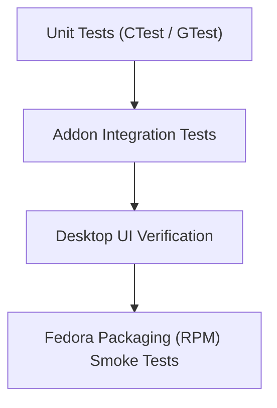

# BanglaKey Linux — Test Plan & Quality Assurance Strategy

This document defines the automated and manual testing strategy for **BanglaKey Linux**.

---

## 1. Testing Hierarchy & Phase Gates

The project enforces strict automated verification before progressing between phases:

---

## 2. Implemented Test Suites

Currently, **49 automated tests** run deterministically via CTest:

### A. Engine Core Unit Tests (`banglakey_unit_tests`, 40 Tests)
1. **Engine Smoke & Lifecycle** (`test_smoke.cpp`):
   - Engine creation, destruction, and mode switching.
   - Bijoy layout direct mapping (`'j'` -> `"ক"`).
   - Bijoy conjunct resolution via link key (`'j'` + `'g'` + `'j'` -> `"ক্ক"`).
   - Phonetic transliteration (`"kh"` + Space -> `"খ "`).
2. **Unicode & Bengali Normalization** (`test_unicode.cpp`):
   - Bengali character classification (independent vowels, consonants, dependent kars, digits, virama).
   - UTF-8 conversion, character counting, and grapheme cluster traversal.
   - Two-part vowel consolidation (E-kar + Aa-kar -> O-kar, E-kar + O-kar -> Ou-kar).
3. **Bijoy Layout Verification** (`test_bijoy.cpp`):
   - Classic & UniJoy base and shifted key mappings.
   - Link key (`'g'`) conjunct formations (double and triple consonants).
   - Pre-vowel sign reordering (E-kar typed before consonant mapped to Unicode canonical order).
   - Reph handling (`'A'` + consonant -> consonant + virama + ra).
   - Backspace, Escape, and shortcut passthrough.
4. **Phonetic Transliteration Verification** (`test_phonetic.cpp`):
   - Standard sentence and word transliteration (`amar sonar bangla` -> `আমার সোনার বাংলা`).
   - Deterministic lexicon overrides (`khoroch`, `ekhon`, `bondhu`, `utsob`, `kkhoma`, `rosto`, `hoThat`).
   - Bengali numeral conversion (`12345` -> `১২৩৪৫`).
   - Candidate generation and hotkey navigation.
   - Buffer editing with Backspace, Delete, and Left/Right arrows.
5. **Composition & Context Isolation** (`test_composition.cpp`):
   - Isolated composition states across multiple `ContextId` sessions.
   - Mode switching preservation: pending text from mode A is committed cleanly before mode B activates.
6. **Engine Configuration** (`test_config.cpp`):
   - Safe validation and rejection of out-of-bounds buffer sizes and candidate limits.

### B. Fcitx5 Addon Integration Tests (`banglakey_fcitx5_tests`, 9 Tests)
Located in `tests/unit/test_fcitx5_addon.cpp`:
1. `AddonRegistrationAndMetadata`: Addon reports name, unique ID, Bengali label, and language code `bn`.
2. `InitialModeIsPhonetic`: Verifies default mode and Bengali submode label.
3. `PhoneticTypingAndSpaceCommit`: Verifies key event routing to preedit and space commitment.
4. `CandidateListGenerationAndHotKeySelection`: Verifies candidate generation and number key selection.
5. `CandidateSelectionViaCandidateWordMethod`: Direct candidate selection callback from Fcitx5 UI.
6. `ModeSwitchViaF12PreservesUnfinishedText`: Hotkey `F12` toggles mode without losing active text.
7. `MultiContextIsolation`: Verifies simultaneous typing across two independent input contexts.
8. `BackspaceAndEscapeHandling`: Verifies preedit editing and cancellation.
9. `ShortcutPassthroughAndCommit`: Verifies system shortcuts (`Ctrl+C`, etc.) pass to client application.

---

## 3. Planned Tests (Future Phases)

1. **Desktop Settings UI Test Suite**:
   - QML component loading and property bindings.
   - Live settings persistence across sessions.
2. **Wayland Text-Input Protocol E2E Testing**:
   - Automated end-to-end typing inside native Wayland clients (Kate, Firefox, LibreOffice).
3. **RPM Installation & Upgrade Testing**:
   - Clean install, upgrade, and removal testing on clean Fedora minimal images.
